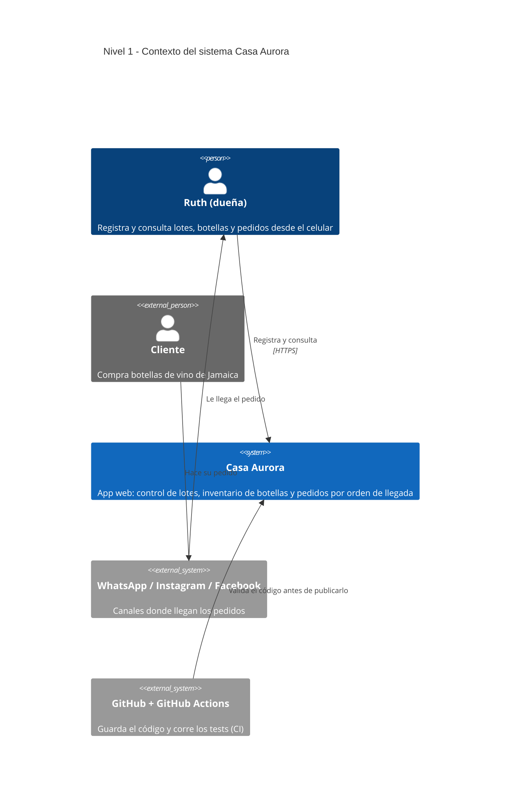
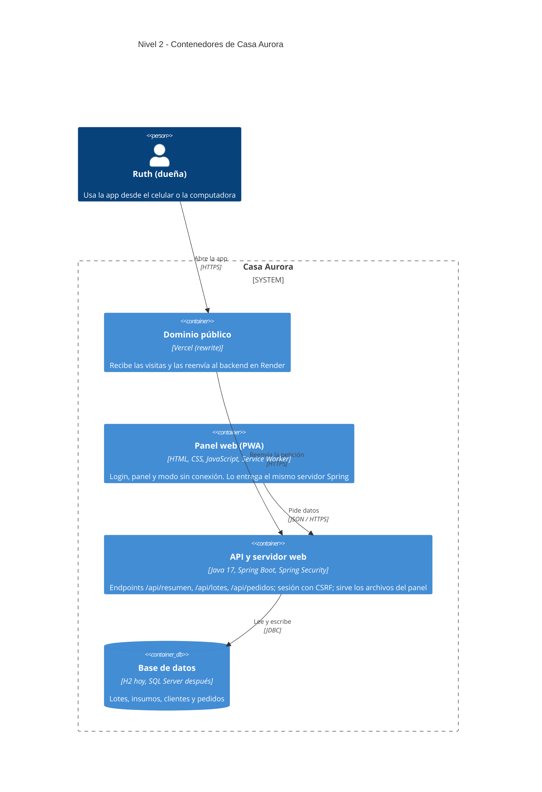

# Práctica 6 · Arquitectura C4 — Casa Aurora

**Sistema:** Casa Aurora, una app web para que la dueña de un emprendimiento de vino de flor de Jamaica (Danlí, Honduras) controle sus lotes, las botellas disponibles y los pedidos pendientes.
**Repositorio del sistema:** https://github.com/AleBueso/casa-aurora
**En producción:** https://casa-aurora-s104.onrender.com

---

## Nivel 1 · Diagrama de contexto

### Justificación del nivel 1

- **Una sola usuaria del sistema.** La app es para la dueña, no para los clientes. Por eso el cliente aparece como persona *externa*: nunca entra a la app.
- **Los pedidos llegan por fuera.** Ruth recibe los pedidos por redes sociales y los anota en Casa Aurora. No se integró ninguna API de WhatsApp o Meta porque el volumen de pedidos es bajo y eso agregaría costo y complejidad sin beneficio real.
- **GitHub Actions es un sistema externo** porque cada push y cada pull request se compila y se prueba antes de llegar a producción.

---

## Nivel 2 · Diagrama de contenedores

### Justificación del nivel 2

| Contenedor | Por qué existe / por qué esa tecnología |
|---|---|
| **Vercel (dominio público)** | Da una URL limpia con HTTPS. Solo reescribe las rutas hacia Render (`vercel.json`), sin código propio, así que no hay un segundo servidor que mantener. |
| **Panel web (PWA)** | HTML y JavaScript simples, sin framework: es lo más sencillo de programar y de mantener. Como PWA, Ruth lo instala en el celular como una app y tiene una página sin conexión. |
| **API Spring Boot** | Contiene toda la lógica de negocio (asignar las botellas por orden de llegada) y la seguridad. Spring Security con un solo usuario administrador alcanza, porque solo la dueña usa el sistema. El mismo servidor entrega el panel, así que se despliega **un solo contenedor** en Render (con un Dockerfile). |
| **Base de datos** | Es relacional porque los datos tienen relaciones claras (un lote usa insumos y abastece pedidos). JPA permite cambiar de motor sin reescribir el código: hoy se usa H2, y el driver de SQL Server ya está en el `pom.xml` para la migración. |

### Decisiones que salen de este diagrama (para el proyecto final)

1. **ADR-001 · Persistencia:** H2 ahora → SQL Server en producción, a través de JPA.
2. **ADR-002 · Autenticación:** un solo usuario ADMIN con sesión y CSRF, en lugar de tokens JWT.
